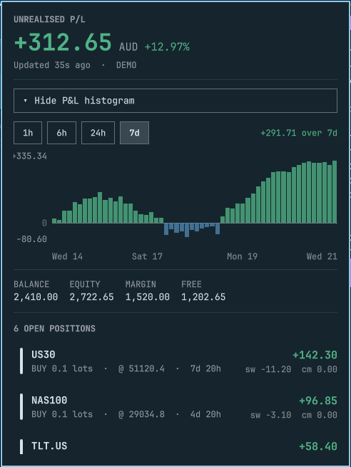

# cTrader P/L — Omarchy shell plugin

Live unrealised P/L from any cTrader broker account in the Omarchy bar. Click
the pill for a portfolio popup listing every open position, what each one is
making or losing, and a P&L histogram over time.

It works with any broker that offers cTrader, because it reads your account
directly through the **cTrader Open API** with credentials you create yourself.
If you trade through a front-end such as TradingView's broker integration, the
positions and P/L still live at the broker, so the figures here match what that
front-end shows.

It is strictly read-only: the OAuth scope requested is `accounts`, not
`trading`, so it cannot place, modify or close an order even if asked to.

Listed in the [Omarchy plugin marketplace](https://plugins.omarchy.org/plugin.html?id=ctrader-pl).



## Requirements

- [Omarchy](https://omarchy.org) with the Omarchy shell
- `python3` (standard library only, nothing to `pip install`)
- A cTrader trading account (demo or live) with a broker that supports cTrader
- Your own cTrader Open API application (free, see below)

## Install

1. **Create your own Open API application.** Sign in at
   <https://openapi.ctrader.com/> with your cTrader ID → **Applications** →
   **Add application**. Set its redirect URI to exactly:

   ```
   http://localhost:7331/callback
   ```

   Once it is approved, note the **Client ID** and **Client secret**. These
   belong to you. Never share them, and never commit them to this or any repo.

2. **Add the plugin:**

   ```bash
   omarchy plugin add https://github.com/gandhik/omarchy-ctrader-pl.git --enable
   ```

3. **Run setup:**

   ```bash
   ~/.config/omarchy/plugins/ctrader-pl/setup
   ```

   Setup links `ctrader-auth` and `ctrader-poll` into `~/.local/bin`, installs
   the `omarchy-ctrader` systemd user service, then runs the auth wizard. The
   wizard asks for your Client ID and secret, opens your browser to authorise,
   lists the trading accounts that authorisation can see, and asks which one to
   track. It then starts the poller.

   Setup authorises a demo account by default. For a live account:

   ```bash
   ~/.config/omarchy/plugins/ctrader-pl/setup --environment live
   ```

### Where your credentials go

Your Client ID, secret and OAuth tokens are written to
`~/.config/omarchy/ctrader/config.json` with mode `0600`. That is outside the
plugin folder, so updating or removing the plugin never touches them, and they
can never end up in a git checkout. Each machine authorises separately.

### Updating

```bash
omarchy plugin update ctrader-pl
systemctl --user restart omarchy-ctrader.service
```

### Uninstalling

```bash
~/.config/omarchy/plugins/ctrader-pl/setup --uninstall           # keeps tokens and history
~/.config/omarchy/plugins/ctrader-pl/setup --uninstall --purge   # deletes them too
omarchy plugin remove ctrader-pl
```

## Using it

| Action | Result |
|---|---|
| Left click the pill | Open/close the portfolio popup |
| Right click | Force the poller to reconnect and refetch |
| Middle click | Copy the total to the clipboard |
| `Esc` in the popup | Close |
| `Enter` in the popup | Refresh |
| **Show P&L histogram** | Expand the P/L-over-time graph in the popup |
| Click a position | Open its chart on TradingView (see `tradingViewExchange`) |
| Hover a bar | Read that bucket's time and figure |

The pill is green in profit, the theme's urgent colour in loss, and neutral when
flat. If the connection drops, it keeps showing the last known figure with the
colour drained out instead of going blank. A stale number is still the best
answer available, as long as it does not look live.

## Configuration

Widget options go in the layout entry in `~/.config/omarchy/shell.json`:

```json
{ "id": "ctrader-pl", "showCurrency": true, "profitColor": "#4fb286" }
```

| Key | Default | Meaning |
|---|---|---|
| `showCurrency` | `true` | Append the account currency to the pill |
| `showAccountRow` | `true` | Show balance/equity/margin in the popup |
| `profitColor` | `#4fb286` | Colour for a positive figure |
| `lossColor` | `""` | Colour for a negative figure; blank uses the theme's urgent |
| `staleAfterSeconds` | `60` | Dim the pill after this long without an update |
| `chartOpenByDefault` | `false` | Start the popup with the histogram expanded |
| `chartRange` | `"6h"` | Window the histogram opens on: `1h`, `6h`, `24h` or `7d` |
| `tradingViewExchange` | `""` | TradingView exchange prefix for your broker's CFDs, e.g. `"MYBROKER"` opens `MYBROKER:EURUSD`. Blank lets TradingView choose a listing |

Share CFDs with a market suffix (`TLT.US`, `BHP.AU`, `.UK`, `.DE`) always open
the underlying exchange listing.

The poll interval lives in `~/.config/omarchy/ctrader/config.json` as
`pollSeconds` (default 10).

Move the widget elsewhere on the bar with:

```bash
omarchy bar move ctrader-pl --section center
```

## How it works

```
cTrader Open API  (TLS, {demo,live}.ctraderapi.com:5036)
            |
      ctrader-poll            systemd user service, polls every 10s
            |
  ~/.local/state/omarchy/ctrader/
        state.json            the snapshot (atomic replace)
        history.jsonl         append-only sample log, 8-day retention
        chart.json            pre-bucketed series for the graph (atomic replace)
            |
      BarWidget.qml           FileView x2, watchChanges
        /        \
   bar pill    Panel.qml
```

Only the poller talks to the broker, and only the bar widget reads the files.
That way the pill, the popup and the graph always agree on what the book is
worth.

`history.jsonl` is the durable log. `chart.json` is a small derivative of it,
bucketed by the poller so the shell re-parses a few KB per tick instead of
doing arithmetic over a week of samples in QML.

| Path | What it is |
|---|---|
| `manifest.json` | Plugin manifest (`kind: bar-widget`) |
| `BarWidget.qml` | The bar pill: reads the state file, owns the colour |
| `Panel.qml` | The portfolio popup |
| `Model.js` | Shared number formatting, plus the chart's geometry helpers |
| `bin/ctrader.py` | cTrader Open API client, standard library only |
| `bin/ctrader-auth` | OAuth setup wizard |
| `bin/ctrader-poll` | Daemon that polls the broker and writes the snapshot |
| `systemd/omarchy-ctrader.service` | Runs the poller for your session, sandboxed |
| `setup` | Links the commands and service, runs the wizard |

Nothing here needs `pip`. The Open API speaks JSON on port 5036 as well as
protobuf on 5035, so `ctrader.py` uses the JSON port and needs no protobuf
runtime. One wire detail was found by probing rather than from the docs:
messages on 5036 are bare JSON objects with **no** length prefix. Sending a
4-byte prefix gets you `Corrupted frame.` back.

## Troubleshooting

```bash
ctrader-poll --once --print          # one snapshot, straight to stdout
systemctl --user status omarchy-ctrader.service
journalctl --user -u omarchy-ctrader.service -f
cat ~/.local/state/omarchy/ctrader/state.json
```

The popup's status line reports the live state: `Live`, `Updated Ns ago`,
`Connecting…`, or the API error verbatim.

- **`CH_CLIENT_AUTH_FAILURE`**: the Client ID or secret is wrong. Re-run `ctrader-auth`.
- **Token errors**: the poller refreshes tokens automatically. If the refresh
  token has also expired (they last about 30 days), re-run `ctrader-auth`.
- **No accounts listed**: the token only sees accounts matching the
  environment. Re-run with `--environment live` or `--environment demo`.
- **Authorising from another machine**: use `ctrader-auth --no-browser` and
  open the printed URL yourself.

## Development

`omarchy plugin add` installs a git checkout, so you can work in it directly:

```bash
cd ~/.config/omarchy/plugins/ctrader-pl
git remote add fork https://github.com/<you>/omarchy-ctrader-pl.git
git switch -c my-change
```

QML and `manifest.json` edits hot-reload on save. **`Model.js` does not**: it is
a `.pragma library`, so the QML engine caches it for the life of the process and
neither saving nor `omarchy-shell shell rescanPlugins` picks up the change. After
editing `Model.js`:

```bash
omarchy restart shell
```

After editing anything in `bin/` or `systemd/`:

```bash
systemctl --user daemon-reload && systemctl --user restart omarchy-ctrader.service
```

Check the manifest before opening a pull request:

```bash
omarchy plugin validate .
```

See [CONTRIBUTING.md](CONTRIBUTING.md) for how to propose changes.

## Roadmap

Ideas not started yet. Pull requests are welcome.

- **Equity series in the histogram.** The chart plots unrealised P/L only, so
  closing a winning position drops the line to zero as the profit moves into
  the balance. Every sample already records `eq` and `bal` alongside `net`, so
  this is a rendering change, not a data one.
- **Pill sparkline.** A last-hour sparkline behind the bar pill.
- **Per-symbol contribution over time.** Which position actually drove the day.
- **Threshold alerts.** A desktop notification via `omarchy-notification-send`
  when total P/L crosses a configurable level.
- **Realised P&L for the session.** Today's closed trades alongside the open book.
- **Margin-level warning.** Colour the margin figure as free margin is consumed.
- **Multi-account switching.** One authorisation covers every linked account;
  the widget currently tracks a single chosen one.

## Disclaimer

This is an independent community project. It is not affiliated with or
endorsed by Spotware (cTrader), any broker, TradingView or Omarchy. Figures are
for information only; your broker's platform is the authoritative record.

## License

[MIT](LICENSE)
